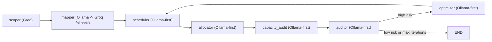

# llm-router-agent

Reusable PM planning agent package for AbleReport.

Distribution name: `llm-router-agent`  
Python import: `llm_router_agent`

## Quickstart

### 1) Install

```bash
cd llm-router-agent
pip install -e .
```

### 2) Set environment variables

```bash
export OLLAMA_MODEL=llama3.1:8b
export OLLAMA_BASE_URL=http://localhost:11434

export GROQ_API_KEY=your_groq_api_key
export GROQ_MODEL=llama-3.3-70b-versatile
```

Optional default:

```bash
export LLM_PROVIDER=ollama
```

### 3) Run demo

```bash
jupyter notebook examples/pm_assistant_demo.ipynb
```

### 4) Run tests (CI-friendly)

```bash
pytest -q
```

## Router Policy

- `scoper` -> ALWAYS Groq
- `mapper` -> Ollama then Groq fallback
- others -> Ollama-first

## JSON Hardening

All JSON-producing nodes use a hardened parse flow:

- strip markdown code fences
- extract first valid JSON object/array from mixed output
- `json.loads` + Pydantic validation
- one repair loop with strict JSON-only instruction
- fallback model/provider if still invalid or node fails

## Architecture


