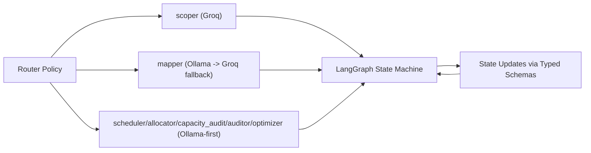

# llm-router-agent

Reusable LLM Router Agent library for AbleReport project planning workflows.

- Distribution: `llm-router-agent`
- Import: `llm_router_agent`
- Routing policy: Groq for `scoper`, Ollama-first for the rest, with explicit mapper fallback to Groq

## Quickstart

1. Create and activate a virtual environment:

```bash
cd llm-router-agent
python -m venv .venv
source .venv/bin/activate
```

2. Install in editable mode:

```bash
pip install -e .
```

3. Set required env vars:

```bash
export GROQ_API_KEY=your_groq_api_key
export LLM_PROVIDER=ollama
export OLLAMA_MODEL=llama3.1
export GROQ_MODEL=llama-3.3-70b-versatile
```

Optional:

```bash
export OLLAMA_BASE_URL=http://localhost:11434
```

4. Run the graph:

```python
from llm_router_agent import Team, TeamMember, build_graph

team = Team(
    team_members=[
        TeamMember(name="Alice", role="Lead", skills=["Python", "Planning"], seniority="Senior"),
        TeamMember(name="Bob", role="Frontend", skills=["React"], seniority="Mid"),
    ]
)

state = {
    "project_description": "Build a customer analytics dashboard",
    "team": team,
    "iteration_number": 0,
    "max_iteration": 2,
    "insights": [],
    "project_risk_score_iterations": [],
}

graph = build_graph()
result = graph.invoke(state)
print(result.keys())
```

Run tests:

```bash
pytest -q
```

## CLI Demo

Deterministic mode:

```bash
python -m llm_router_agent.cli \
  --ai-key fixtures/ai_key/no_sound_audio_engine_off.json \
  --llm-provider none \
  --no-llm
```

Require LLM mode (validated output):

```bash
python -m llm_router_agent.cli \
  --ai-key fixtures/ai_key/no_sound_audio_engine_off.json \
  --llm-provider ollama \
  --llm-model llama3.1:latest \
  --require-llm
```

## Architecture



## How This Helps AbleReport

- Deterministic JSON IO: strips fences, extracts JSON from mixed text, validates with Pydantic, and repairs malformed payloads.
- Per-node routing: provider selection is explicit and centralized, so scoping, mapping, and execution behavior are predictable.
- Reusable node contracts: each node is a pure state-update function with stable input/output schema boundaries.
